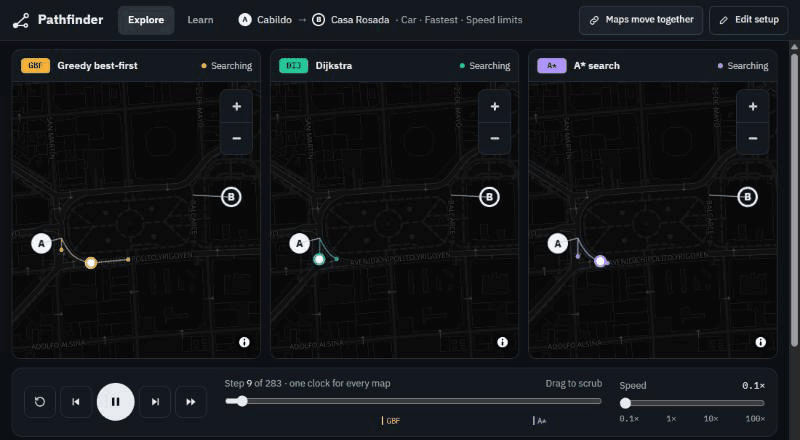

# Pathfinder

[](https://github.com/markmysler/pathfinder/actions/workflows/ci.yml)
[](LICENSE)

Learn graph search by watching algorithms route across real streets. Pick a start and a
destination anywhere on Earth, up to 15 km apart. Choose one or more algorithms and watch each one
explore the road network: play it, slow it down, step through it one expansion at a time, or
compare up to six side by side.

**[Open Pathfinder](https://markmysler.github.io/pathfinder/)**, then press **Try a sample route**
to see three algorithms race across Plaza de Mayo at once, with no download.



- **Explore:** BFS, DFS, greedy best-first, Dijkstra and A* (with a weight on its estimate).
  Bidirectional BFS, Dijkstra and A*. Bellman-Ford, ALT (landmarks) and contraction hierarchies,
  with their preparation shown as a step of its own. By car, bike or on foot, for the fastest or
  the shortest route. An inspector shows the frontier, the current pseudocode line and the costs
  behind each step.
- **Learn:** an article for every algorithm and for the foundations (graphs, roads as graphs,
  frontiers, estimates), with diagrams you can step through. The diagrams are driven by the same
  code that runs on the map.

Pathfinder works on a phone as well as on a desktop.

## Privacy and keys

Pathfinder has no server of its own and no analytics. Your browser talks directly to:

- **OpenStreetMap services**: Overpass for the streets around A and B, Nominatim for address
  search, and OpenFreeMap for the map's tiles. These see the area you search and your IP address,
  as with any website.
- **TomTom or HERE**, only if you add your own key for live traffic. The key is kept in this
  browser's local storage and sent only to the provider it belongs to. Requests count against
  your own quota. Without a key, cars use speed limits, and bikes and walking use average speeds.

The site's Content Security Policy allows only these hosts.

## Offline

Pathfinder can be installed as an app, and once visited it opens without a connection: Learn in
full, and Explore for routes you have run before. On the first visit it downloads the whole app in
the background for this: about 1.1 MB, most of which Explore loads anyway. The streets for each
route you run are kept on the device for a week after its last run, along with the map tiles you
have seen. Offline, the plan lists these saved routes with their size, and you can remove any of
them. A and B can move anywhere inside a saved route's area. The sample route always works
offline. Address search, live traffic and new areas need a connection.

## Development

Requires Node 22.18 or newer (CI also runs on 24).

```sh
npm install
npx playwright install chromium   # once, for e2e tests
npm run dev                        # dev server
npm test                           # unit tests (Vitest)
npm run test:e2e                   # e2e tests on desktop and phone, then Lighthouse (Playwright)
npm run lint && npm run typecheck && npm run format:check
```

Read [docs/CONTRIBUTING.md](docs/CONTRIBUTING.md) before changing anything: the project is
test-first, and interface changes are designed for phones and desktops together.
[docs/ARCHITECTURE.md](docs/ARCHITECTURE.md) explains how a run gets from "Run" to the map, and
ends with what was measured while building it.

## License

The code is [MIT](LICENSE). Map data, including the streets bundled for tests and the sample
route, is © [OpenStreetMap contributors](https://www.openstreetmap.org/copyright), under the Open
Database License.
